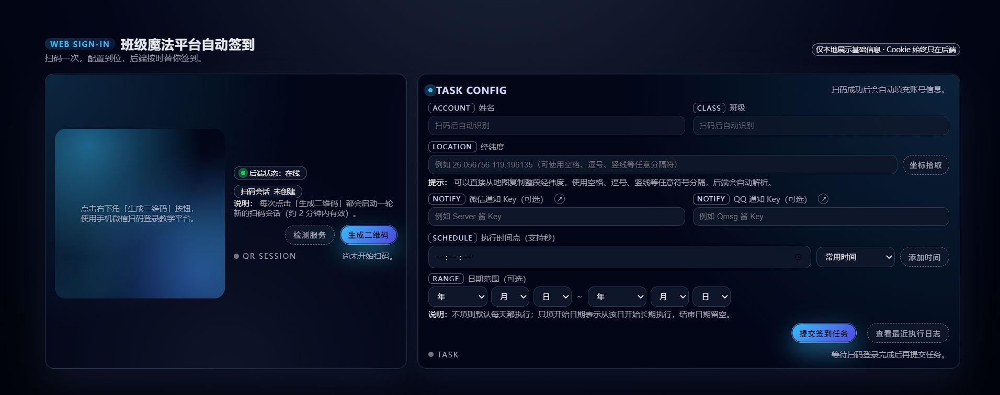
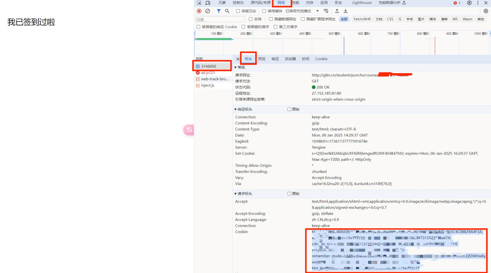

# 班级魔方多人GPS自动签到

- Thanks To [JasonYANG170/AutoCheckBJMF](https://github.com/JasonYANG170/AutoCheckBJMF) ，根据自己学校的签到进行了简化
- 仅根据自己学校的班级魔方需求更改简化代码,其他功能请到项目[AutoCheckBJMF](https://github.com/JasonYANG170/AutoCheckBJMF)项目查看其他内容
- 可配置多人签到
- 可配置QQ/WX通知签到情况
- 上游 [emocat17/AutoSignBJMF](https://github.com/emocat17/AutoSignBJMF) 已于 2026.09.01 停止维护，本仓库在此基础上继续维护
- 如果你觉得好用,`Please Star`orz
  

> 上游原作者的学校签到方式已变更，签到逻辑因此不再更新；本仓库保留了 GPS 签到这条仍然可用的路径，
> 并补齐了「到点一定能跑」的三种运行方式。

## 三种运行方式

| 方式 | 适合谁 | 特点 |
| --- | --- | --- |
| [GitHub Actions](#方式一github-actions免服务器) | 不想养机器的人 | 零成本，但官方文档明确说明 `schedule` 事件在高负载时段会被延迟，定时不保证准点 |
| [本地常驻](#方式二本地常驻到自己电脑上跑) | 白天电脑常开的学生 | 用系统本地时间触发，到点即跑，不受 Actions 排队影响 |
| [服务器部署](#方式三服务器部署docker-或-systemd) | 有 VPS /  NAS 的人 | 24 小时在线，最稳定 |

三种方式最终执行的都是同一套签到逻辑（`BJMF.py`），只是触发器不同。

## 代码结构

```
AutoSignBJMF/
├── BJMF.py                     # 主程序，负责整体流程控制
├── signin_loop.py              # 本地/服务器常驻脚本，按时间点每天定时执行 BJMF.py
├── auto_add_user.py            # 自动添加用户工具，通过微信扫码获取用户信息并写入 data.json
├── requirements.txt            # 命令行版依赖
├── requirements-dev.txt        # 开发/测试依赖
├── .env                        # (可选) 环境变量配置文件，用于配置公共参数
├── .github/workflows/
│   └── auto-signin.yml         # GitHub Actions 定时签到
├── deploy/
│   ├── register-windows-task.ps1   # Windows 计划任务注册脚本
│   └── signin-loop.service         # Linux systemd 常驻单元
├── tests/                      # pytest 单元测试（全程 mock，不会触发真实签到）
├── utils/                      # 工具模块目录
│   ├── __init__.py             # 模块初始化文件
│   ├── config_manager.py       # 配置文件管理模块
│   ├── user_info.py            # 用户信息获取模块
│   ├── notification.py         # 通知发送模块
│   └── attendance.py           # 签到任务执行模块
└── web_signin/                 # Flask + APScheduler 的 Web 管理端
```

### 各模块职责

- **BJMF.py**: 主程序入口，负责读取配置、遍历用户、调用签到任务
- **signin_loop.py**: 常驻调度，睡眠到设定时间点再调用 `BJMF.py`
- **auto_add_user.py**: 自动添加用户工具，通过微信扫码自动获取 Cookie 和班级信息并写入 `data.json`；支持读取 `.env` 公共配置
- **config_manager.py**: 处理配置文件的读取和保存
- **user_info.py**: 获取用户信息和班级信息
- **notification.py**: 处理QQ和微信消息发送
- **attendance.py**: 执行签到任务的核心逻辑

## 功能

- 自动从指定课程中获取签到项（同时探测 `punchs` 与 `daka` 两类模块）
- 通过模拟表单提交，实现自动签到
- 签到成功后,发送QQ/WX消息通知(可选配,可以不用配置)
- 支持通过微信扫码快速添加用户
- 支持 `.env` 配置公共参数，简化多人配置

## 更新说明

- 2026.11.05
  - 新增 `signin_loop.py`：本地/服务器常驻定时，不依赖终端保持打开
  - 新增 `deploy/`：Windows 计划任务注册脚本、Linux systemd 单元
  - 新增 `tests/`：76 个 pytest 用例覆盖签到后端，全程 mock 不发真实请求
  - 新增 GitHub Actions 自动签到（可用，但注意官方延迟说明）
  - 修复: 以 `python web_signin/run.py` 启动时，Web 版定时任务因项目根不在 `sys.path` 上而必然失败
  - 修复: 登录态 Cookie 名随学校变化，改为按 `remember_student_` 前缀提取；提取不到时整串发送，`PHPSESSID` 会话不再直接报错
  - 修复: 汇总通知缺少超时，可能拖挂定时任务
  - 合并上游 `emocat17/AutoSignBJMF` 的签到检测逻辑重构
  - 统一依赖：`requests` 版本冲突、移除未使用的 `DateTime` 与 `bs4` 占位包
  - 补充 MIT 许可证

- 2026.01.10
  - `auto_add_user.py` 优化: 支持通过 `.env` 文件配置公共参数(经纬度、通知Key等)，简化配置流程
  - `auto_add_user.py` 优化: 增加二维码自动清理机制，避免垃圾文件堆积及文件占用问题
  - `utils/attendance.py` 修复: 优化签到状态检测逻辑，增加对"已签到"状态的HTML解析，解决正则匹配失败导致的误报问题

- 2025.12.15
  - 更新 `utils/attendance.py` ,改用 requests.Session()防止获取签到项失败问题；同时增加了对 response.url 的检测

- 2025.12.04 v2版本
  - 新增 `auto_add_user.py` 工具，实现微信扫码自动获取用户信息并写入配置文件data.json
  - 简化了用户添加流程，无需手动获取Cookie和班级ID

## 环境准备

需要 **Python 3.10 及以上**（代码使用了 `str | None` 语法）。

```bash
git clone https://github.com/iceblyte/AutoSignBJMF.git
cd AutoSignBJMF

# 建议用虚拟环境
python -m venv .venv
# Windows
.venv\Scripts\activate
# Linux / macOS
source .venv/bin/activate

# 命令行版依赖
pip install -r requirements.txt
```

## 配置指南

### 方法一：自动添加用户 (推荐)

最简单的方法，无需手动抓包或查找 Cookie。

1. **(可选) 配置公共参数**：
   在项目根目录下创建 `.env` 文件（可从 `.env.example` 复制），填入经纬度等公共信息。
   ```properties
   # 是否启用公共配置 (True/False)
   ENABLE_COMMON_CONFIG=True

   # 公共配置参数
   COMMON_LAT=xxxxxx  # 纬度
   COMMON_LNG=xxxxxx  # 经度
   COMMON_ACC=30      # 精度
   COMMON_QMSG_KEY=   # Qmsg推送Key(可选)
   COMMON_WX_KEY=     # Server酱推送Key(可选)
   ```

2. **运行自动工具**：
   ```bash
   python auto_add_user.py
   ```

3. **扫码登录**：
   使用微信扫描弹出的二维码，程序会自动获取 Cookie 和班级信息并保存到 `data.json`。

### 方法二：手动配置 (高级)

如果你需要手动配置 `data.json`，可以按照以下步骤获取参数。

#### 1. data.json 格式

从 `data.json.example` 复制一份改名为 `data.json`：

```json
{
    "students": [
        {
            "name": "用户备注",
            "class": "123456",
            "lat": "30.123456",
            "lng": "120.123456",
            "acc": "30",
            "cookie": "从浏览器获取的Cookie字符串",
            "QmsgKEY": "",
            "WXKey": ""
        }
    ]
}
```

> `WXKey` / `QmsgKEY` 写在每个学生对象里；留空则该学生不发通知。

#### 2. 参数获取说明

- **Cookie 获取方法 (PC端浏览器)**：
  1. 电脑微信登录并打开签到页面：`http://g8n.cn/student/login?ref=%2Fstudent`
  2. 按 `F12` 打开开发者工具，切换到 **网络 (Network)** 标签。
  3. 刷新页面，在左侧请求列表中找到第一个请求（通常是数字或 student）。
  4. 点击该请求，在右侧 **标头 (Headers)** -> **请求标头 (Request Headers)** 中找到 `Cookie`。
  5. 复制 `Cookie:` 后面的所有内容（通常以 `PHPSESSID=...` 或 `remember_student_...` 开头）。
  
  

- **Class (班级ID)**：
  - 在上述浏览器页面的网址栏中，可以看到类似 `course/123456` 的内容，`123456` 即为班级ID。
  - 或者在页面中查看。
  

- **经纬度 (Lat/Lng)**：
  - 使用 [高德地图坐标拾取器](https://lbs.amap.com/tools/picker) 获取。

- **推送 Key (可选)**：
  - **Qmsg酱**: [官网](https://qmsg.zendee.cn/) 注册获取 Key。
  - **Server酱**: [官网](https://sct.ftqq.com/) 扫码获取 Key。

## 手动执行一次签到

```bash
python BJMF.py
```

无论用哪种自动方式，都建议先手动跑一次确认配置无误。

---

## 方式一：GitHub Actions（免服务器）

仓库已内置 [`.github/workflows/auto-signin.yml`](.github/workflows/auto-signin.yml)，每天定时执行一次签到，失败后每隔 10 分钟重试，最多 3 次。

### 配置步骤

1. **把 `data.json` 的内容存成 Secret**
   仓库页面 → `Settings` → `Secrets and variables` → `Actions` → `New repository secret`
   - Name: `DATA_JSON`
   - Secret: 粘贴 `data.json` 的**完整 JSON 文本**

2. **启用 workflow**
   仓库页面 → `Actions` → 顶部若出现 "This workflow is disabled" 提示 → `Enable workflows`。
   （仓库转公开、或长期没有运行记录时，GitHub 会把定时 workflow 置为 `disabled_manually` / `inactive`，必须手动启用，否则 cron 不会跑。）

3. **验证**
   `Actions` → `自动签到` → `Run workflow` 手动触发一次，看日志里是否签到成功。

### 关于定时时间

```yaml
schedule:
  - cron: '31 13 * * *'   # UTC 13:31 = 北京时间 21:31
```

cron 用的是 **UTC**，不是本地时间。北京时间换算成 UTC 要减 8 小时。

> ⚠️ **定时不保证准点。** GitHub 官方文档明确说明 `schedule` 事件在执行高峰期会被延迟，
> 且最短间隔为 5 分钟、同一账户的定时任务过多时还可能被丢弃。
> 实测延迟可能从几分钟到几小时——如果你学校的签到窗口很短，请改用下面两种常驻方式。

## 方式二：本地常驻（自己电脑上跑）

`signin_loop.py` 是一个纯标准库的常驻进程：按**系统本地时间**睡眠到点，再调用 `BJMF.py`，跑完继续等下一个点。

```bash
# 先验证一次配置（立即执行一次后退出）
python signin_loop.py --once

# 常驻：每天 07:30 和 21:31 执行
python signin_loop.py --times 07:30,21:31
```

关掉终端进程就没了，所以配一个登录自启：

```powershell
# 需要管理员权限，注册一次即可（会隐藏控制台窗口）
.\deploy\register-windows-task.ps1 -Times 07:30,21:31

# 只想用 Web 管理端常驻
.\deploy\register-windows-task.ps1 -Mode web

# 先看看会注册什么，不改系统
.\deploy\register-windows-task.ps1 -DryRun

# 卸载
.\deploy\register-windows-task.ps1 -Uninstall
```

查看与手动触发：

```powershell
Get-ScheduledTask -TaskName BJMF-AutoSignIn
Start-ScheduledTask -TaskName BJMF-AutoSignIn
```

## 方式三：服务器部署（Docker 或 systemd）

### Docker（Web 管理端 + 内置调度）

`web_signin/` 自带 APScheduler，进程常驻即可每天按点执行，任务配置存在 SQLite 里。

```bash
# 用 compose 起（推荐）
docker compose up -d

# 或手动构建
docker build -t bjmf-web -f web_signin/Dockerfile .
docker run -d --name bjmf-web -p 9988:9988 --restart unless-stopped bjmf-web
```

访问 `http://服务器IP:9988` 扫码配置任务，时间点精确到秒，按 `Asia/Shanghai` 解释。

> 注意：容器重建会丢失数据库，请把 `./web_signin/db` 留在宿主机（compose 已挂载）。
> 安全提示：用户侧接口（`/api/qr`、`/api/tasks`、`/api/user/config`）**不做鉴权**，能访问端口的人即可提交和读取含 Cookie 的任务；
> 只有 `/api/admin/*` 需要管理员 Key。因此本地运行时默认只监听 `127.0.0.1`，
> 需要对外服务时再显式设置 `WEB_SIGNIN_HOST=0.0.0.0`（Docker 镜像内已设置），并自行加一层反向代理鉴权或防火墙限制。

### systemd（命令行常驻）

```bash
sudo cp deploy/signin-loop.service /etc/systemd/system/
# 按实际路径修改 WorkingDirectory / ExecStart
sudo systemctl daemon-reload
sudo systemctl enable --now signin-loop

# 看日志
journalctl -u signin-loop -f
```

---

## web_signin Web 管理端

`web_signin/` 提供了一个基于 **Flask + APScheduler** 的 Web 管理界面，用于在浏览器中扫码添加用户、配置多个时间点和查看签到日志。

### 本地直接运行

1. 安装 Web 版依赖（在项目根目录执行）：
   ```bash
   pip install -r web_signin/requirements.txt
   ```
2. （可选）复制配置模板：
   ```bash
   cd web_signin
   copy config.json.example config.json  # Windows
   # 或
   cp config.json.example config.json    # Linux / macOS
   ```
   如需自定义端口，可在 `config.json` 中填写 `"port": 9988`，或通过环境变量 `WEB_SIGNIN_PORT` 覆盖。
3. 启动 Web 服务：
   ```bash
   python web_signin/run.py
   ```
4. 在浏览器访问 `http://127.0.0.1:9988`。若修改了端口，请替换 `9988`。

## 开发：跑测试

测试全程使用 mock，**不会发出真实网络请求，也不会产生真实签到**，可以放心反复运行。

```bash
pip install -r requirements-dev.txt
pytest
```

覆盖范围：`attendance` 的六种状态分支与多模块探测、`user_info` 的 Cookie 提取与页面解析、`notification` 的消息格式与超时、`config_manager` 的读写、`BJMF.py` 的 WXKey 选取与班级回填、`signin_loop` 的时间计算、`web_signin` 调度器的时区与日志状态映射。

## 文件与隐私说明

- `data.json`、`.env`、`web_signin/config.json`、`web_signin/db/` 包含个人 Cookie、经纬度、推送 Key，
  **已全部写入 `.gitignore`，不会被提交**，请自行保管。
- 签到失败时程序会在当前目录生成 `debug_html.txt`（页面快照，含真实姓名与班级 ID），同样已被忽略；
  **对外分享日志或截图前，请手动打码或删除其中的 Cookie、班级 ID、经纬度等隐私信息。**
- 本仓库的历史记录已重做为干净快照，不包含任何 Cookie、Key 或他人信息。

## 注意事项

- 程序会自动检测并填充空的 class 字段。
- 签到二维码/Cookie 具有时效性，如果签到失败（提示 Cookie 无效），请重新运行 `auto_add_user.py` 更新凭证。
- 长时间没有运行（例如 Actions 被停用）后，务必先 `python BJMF.py` 手动验证一次 Cookie 是否还有效。

## 许可证

本项目基于 [MIT License](LICENSE) 开源。
